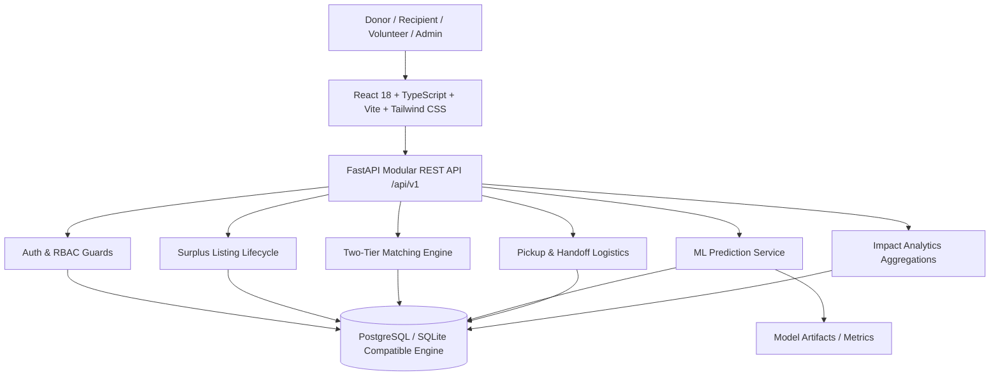

# FoodRescue AI — Predictive Surplus Detection & Intelligent Redistribution

FoodRescue AI transforms edible food surplus from a last-minute emergency into a forecastable, traceable, and actionable redistribution workflow. It connects donors (restaurants, caterers, bakeries, grocery) with verified recipient organizations (shelters, community kitchens, food banks) and logistics coordinators.

---

## 🌟 Key Features

1. **Editorial & Tactile Interface**: Warm cream canvas (`#FFF8EE`), asymmetric Pinterest-inspired card compositions, organic shapes, and selective glassmorphism—avoiding generic dark-mode SaaS templates.
2. **Machine Learning Surplus Forecasting**:
   - Compares a **7-day seasonal rolling baseline (MAE: 12.07 kg)** against a **`HistGradientBoostingRegressor` (MAE: 4.50 kg)**, delivering a **62.7% reduction in forecasting error**.
   - Generates multi-day surplus point estimates with shaded 90% uncertainty intervals.
   - Transparent cold-start rule heuristics when kitchen history is sparse.
3. **Two-Tier Explainable Matching Engine**:
   - **Tier 1 (Hard Eligibility Constraints)**: Enforces administrator verification, certified cold/dry storage capacity, pickup deadline viability, allergen compatibility, and service area boundary (Haversine distance).
   - **Tier 2 (Multi-Factor Soft Scoring [0–100])**: Ranks eligible recipients on proximity, capacity fit ratio, verified handling, and rotation fairness.
   - Provides clear human-readable rationale tags (e.g., *"Within 3.2 km service radius"*, *"Optimal volume match: 75% capacity"*).
4. **End-to-End Pickup & Logistics Timeline**:
   - Mobile-first status tracking: `Scheduled` → `Arrived` → `Collected` → `Delivered` → `Handoff Confirmed`.
   - Temperature logging, quantity mismatch audits, and exception tracking.
5. **Verifiable Impact Analytics**:
   - Directly aggregates persisted database records: total rescued kilograms, meals saved estimate ($1\text{ meal} \approx 0.42\text{ kg}$), and greenhouse gas emissions avoided ($1\text{ kg food} \approx 2.5\text{ kg }\text{CO}_2\text{e}$).
   - Zero hardcoded numbers or placeholder charts in production.
6. **Administrator Verification Queue**:
   - Entity credential review and immutable security audit logging.

---

## 🛠️ Architecture & Tech Stack



- **Frontend**: React 18, TypeScript, Vite, Tailwind CSS, Framer Motion, Lucide React, Recharts.
- **Backend**: Python 3.11+, FastAPI, SQLAlchemy 2.0 (dual PostgreSQL & SQLite compatibility), Pydantic v2, PyJWT, Passlib (Bcrypt).
- **Machine Learning**: Scikit-learn (`HistGradientBoostingRegressor`), Pandas, NumPy, Joblib.

---

## 🚀 Quickstart Guide

### 1. Prerequisites
- Python 3.11+
- Node.js 18+ and `npm` or `pnpm`
- (Optional) Docker & Docker Compose for containerized PostgreSQL

### 2. Backend Setup
```bash
# 1. From workspace root, copy environment configuration
cp .env.example .env

# 2. Install backend dependencies
pip install -r backend/requirements.txt

# 3. Train ML Surplus Model and evaluate against baseline
python backend/ml/train.py

# 4. Initialize and seed database with demo accounts
python -c "import sys; sys.path.insert(0, 'backend'); from app.db.seed import seed_database; seed_database()"

# 5. Start FastAPI development server
uvicorn app.main:app --app-dir backend --reload --port 8000
```
API Documentation will be available at [http://localhost:8000/docs](http://localhost:8000/docs).

### 3. Frontend Setup
```bash
# 1. Navigate to frontend directory
cd frontend

# 2. Install frontend dependencies
pnpm install # or npm install

# 3. Start Vite development server
npm run dev
```
Open [http://localhost:5173](http://localhost:5173) in your browser.

---

## 👥 Seed Demo Accounts

Use the built-in demo persona switcher in the top navigation bar, or log in with these pre-seeded accounts (password for all is `password123`):

| Role | Email | Password | Organization / Persona |
| :--- | :--- | :--- | :--- |
| **Donor** | `donor@bistro.demo` | `password123` | **Green Garden Bistro** (Restaurant, Downtown) |
| **Donor** | `bakery@artisan.demo` | `password123` | **Golden Crust Bakery** (Bakery, Nob Hill) |
| **Recipient** | `director@hopekitchen.demo` | `password123` | **Hope Community Kitchen** (Verified NGO Kitchen) |
| **Recipient** | `shelter@haven.demo` | `password123` | **St. Jude Shelter** (Verified Shelter) |
| **Recipient** | `pending@newcharity.demo` | `password123` | **New Horizons Food Pantry** (Awaiting Admin Review) |
| **Volunteer** | `volunteer@rescue.demo` | `password123` | **Alex Taylor** (Logistics Coordinator) |
| **Admin** | `admin@foodrescue.ai` | `password123` | **Platform Administrator** (Verification Queue & Audit) |

---

## 🧪 Testing & Verification

```bash
# Run backend test suite
python -m pytest backend/tests -v

# Run frontend TypeScript type-check and production build
cd frontend
npm run build
```

---

## ⚠️ Food Safety & Product Disclaimers
1. **Human Confirmation**: The matching engine provides decision support ranking; human operators retain all final food safety inspection and donation approval responsibility.
2. **Cold-Start Estimates**: When an organization has fewer than 5 historical surplus records, a transparent heuristic baseline is displayed with clear UI disclosures.
3. **Environmental & Meals Metrics**: Calculations use standard FAO nutritional ($0.42\text{ kg/meal}$) and climate factors ($2.5\text{ kg }\text{CO}_2\text{e/kg}$) and are labeled as estimates.

